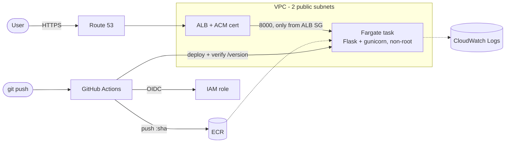

# URL Shortener on AWS ECS 

A small Flask URL shortener deployed to **AWS ECS ** behind an **ALB with HTTPS**, built as a DevOps portfolio project:
containerised with a hardened multi-stage Dockerfile, provisioned with modular **Terraform**, and deployed by **GitHub Actions using OIDC** (no long-lived AWS keys) with post-deploy verification and automatic rollback. 

## Architecture

